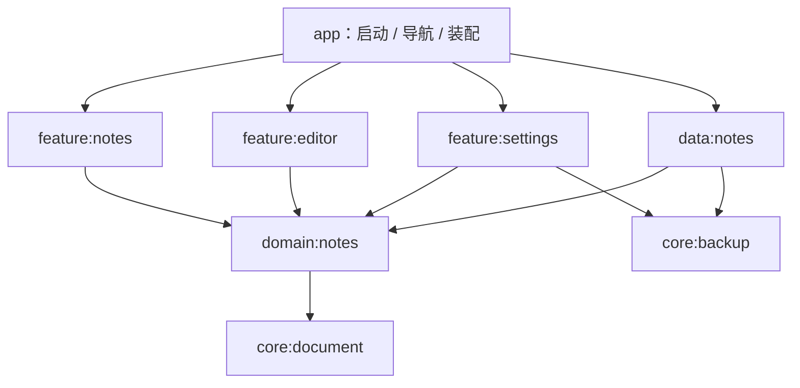

# ADR-001：Android 模块化单体架构

日期：2026-10-18。

状态：本轮架构选型决定，供后续工程实施使用；尚未创建工程或通过运行验收。本决策替代此前“单个 app 模块起步”的初步目录参考。

## 1. 选型结论与比较

采用 **Kotlin + Jetpack Compose 的模块化单体架构**：一个 Android 安装包，以 Gradle 模块隔离主要职责；按业务域组织功能，界面采用 ViewModel + 单向数据流（UDF），业务通过 Repository 接口访问数据，复杂操作使用 Use Case。借用 Clean Architecture 的依赖方向与可测试性，不要求每次调用都套三层转发。

| 方案 | 优点 | 本项目取舍 |
| --- | --- | --- |
| 单个 app 模块内按功能分包 | 构建简单、初期文件少 | 可做小应用，但对未来多业务及多 AI 接手的依赖约束较弱，不选为整体方案 |
| 适度多模块的模块化单体 | 编译边界清晰，可独立测试，仍只维护一个 App | **选用**；按真实功能逐步创建模块 |
| 每个页面都拆完整 data/domain/presentation 模块 | 隔离细，但配置与转发代码多 | 不选；按业务域拆分，不按页面数量拆模块 |
| 动态插件平台、微服务、跨平台框架 | 适用于另有部署或跨平台要求的产品 | 当前没有对应需要，不建设插件运行时、服务端或多平台层 |

MVVM/UDF 描述界面状态流，模块化描述工程边界，Repository/Use Case 描述业务与数据依赖；它们是不同层次的选择，不是互斥框架。

## 2. 已选技术与实施默认值

| 部分 | 选择 |
| --- | --- |
| 平台与工具链 | 原生 Android、Kotlin、Gradle Kotlin DSL、JDK 17；单 Activity |
| UI | Jetpack Compose + Material 3，自定义已确认的主题颜色，不由系统动态配色覆盖默认设计 |
| 状态 | AndroidX ViewModel、Coroutines、Flow/StateFlow、生命周期感知收集；不引入额外 MVI 状态框架 |
| 导航 | **Navigation 3 稳定版**；应用层管理类型化导航目标和返回栈 |
| 依赖装配 | **Hilt**，优先构造函数注入；纯 Kotlin 业务接口不依赖 Hilt/Android |
| 正文与附件 | App 内部私有文件目录管理 UTF-8 Markdown 和独立附件；系统文件选择器负责外部导入导出 |
| 本地结构化存储 | **Room**：应用状态与派生索引明确区分；不把正文数据库化为另一份权威内容 |
| 简单设置 | **Preferences DataStore**：主题、字号等；不保存正文、密钥或大型业务对象 |
| 序列化 | Kotlinx Serialization 用于本项目 JSON/类型化导航；不用于重写未知 YAML 字段 |
| 测试 | JUnit、kotlinx-coroutines-test；Android 场景使用 AndroidX Test 与 Compose UI Test，优先可控的 fake |
| AI/网络 | 一期不安装聊天或网络业务栈；二期结合见域统一选型，不先复制 Retrofit/OkHttp 代码 |
| 后台工作 | 发生真实持久任务需求时再接 WorkManager；不能用它保证精确提醒，也不能用它代替即时编辑保存 |

2026-10-18 核对官方发布页，Navigation 3 已有稳定版（1.2.0），因此选择它而非照搬见域旧版 Navigation Compose。Hilt、Room、Compose 等具体版本由实施者选用兼容的稳定组合，集中固定到 `gradle/libs.versions.toml`；不使用动态版本，不为追新改变本决策。Gradle/AGP/Kotlin/KSP 与 JDK 17 的兼容性须以实际构建验证，遇到冲突先报告，不擅自更换整套架构。

仅交付用户的小米 14 Ultra。`minSdk = 26` 作为构建起始默认值，不代表承诺所有 Android 8 设备均通过体验验收；compile/target SDK 在工程创建时选择兼容的稳定值并记录。目标手机的实际系统版本、输入法和 WebView 版本由首次设备验收记录，不从机型名称猜测。

## 3. 模块边界与依赖

下面是一期逐步落地的边界，不要求初始化时创建十个空模块。

| 模块 | 职责与公开边界 | 允许依赖的项目模块 |
| --- | --- | --- |
| `:app` | 启动、导航组装、Hilt 装配、系统入口；不承载笔记业务 | 实际启用的 feature、data 和 core 模块 |
| `:core:document` | 纯 Kotlin 文档类型、路径/引用模型、语法处理适配边界；保留原文 | 无业务模块依赖 |
| `:core:designsystem` | 主题、排版、通用组件 | 无业务模块依赖 |
| `:core:preferences` | 设置访问接口和 DataStore 实现 | 无业务模块依赖 |
| `:core:backup` | 简单备份包读写、恢复流程及数据参与接口 | 无 feature/data/notes 依赖 |
| `:domain:notes` | 纯 Kotlin 笔记模型、Repository 接口、必要 Use Case | `core:document` |
| `:data:notes` | Repository 实现，文件、附件、草稿、Room、索引与恢复协调；提供笔记备份参与实现 | `domain:notes`、`core:document`；接备份后依赖 `core:backup` |
| `:feature:notes` | 笔记列表、目录/标签、本地搜索的 Route、ViewModel、Screen | `domain:notes`、`core:designsystem` |
| `:feature:editor` | 阅读、源码/实时预览编辑、输入与渲染适配、保存 UI 状态 | `domain:notes`、`core:document`、`core:designsystem`、`core:preferences` |
| `:feature:settings` | 外观、导入导出、备份恢复的设置入口与流程 UI | `core:preferences`、`core:backup`、`core:designsystem`、`domain:notes` |

设置备份参与实现放在 `core:preferences` 内，在接备份功能时允许其依赖 `core:backup`；备份引擎不能反向依赖设置或笔记模块。App 显式装配参与者，不做运行时扫描、插件安装或事件总线。

图省略主题和设置依赖，完整约束以上表为准。箭头表示编译依赖，不代表运行时数据流。

硬性规则：feature 不依赖其他 feature 或 data 实现；data 不依赖 feature；domain 不依赖 Android、Compose、Room、Hilt。跨 feature 跳转由回调交给 app，参数只传标识及定位信息，不传整个笔记正文、DAO 或 ViewModel。具体实现类型尽量 `internal`，公开接口保持小而明确；禁止全局 Service Locator、业务万能 Manager 和通用事件总线。

需要复杂一致性的保存/重命名/恢复使用 Use Case；简单列表观察和读取可直接调用 Repository，避免空壳转发。不可因每层存在就为同一模型机械创建多套 DTO。

## 4. 数据归属与文件可靠性

用户已选择 App 管理文件夹，通过导入导出和后期同步与电脑交换。一期不开放外部 App 直接编辑活动笔记库，也不请求全盘文件管理权限。

| 数据 | 权威来源 | 恢复原则 |
| --- | --- | --- |
| 正文、YAML 标签/别名、文件夹层级和附件 | 私有目录内 Markdown 与附件文件 | 导出保留可供 Obsidian 使用的结构；未修改内容不能因打开/保存而被格式化清洗 |
| 笔记内部 ID、ID 与路径映射、置顶、阅读位置等 | 笔记模块的 Room 状态库 | 属于需备份的应用状态，不能当作缓存随意清空 |
| 搜索正文、引用关系、摘要等派生数据 | 独立 Room 索引库 | 可从文档重建；索引中的正文副本不能反向覆盖文件 |
| 未保存草稿与未完成文件操作记录 | 私有目录内独立恢复文件 | 用于崩溃恢复，不能当作已保存正文；备份时明确处理尚未保存内容 |
| 主题和字号 | DataStore | 完整备份包含用户设置 |

内部 ID 不由文件名生成，也不强制写入用户 YAML。重命名保留 ID，通过映射定位新路径；完整恢复保留 ID。单纯导入 Markdown 可生成新的内部 ID，不承诺自动恢复应用专属关联；完整备份负责保存这些关联。这一约定不提前决定第三期跨设备身份协议。

所有正文写入经过笔记 Repository，UI、AI、导入器和未来同步不能绕过它。至少提供观察列表/读取文档、带预期版本的保存、创建、重命名/移动、回收/恢复、附件导入和搜索等明确操作；返回已提交、版本冲突或失败等可识别结果，不以发起写入等同成功。

保存采用同目录暂存文件完成写入后替换；采用存储层串行协调及版本检查，防止旧保存覆盖新编辑。实际文件成功后才报告保存成功；索引失败单独标记待更新并可重建，不把已落盘内容误报丢失。多文件链接更新无法依赖 Room 事务实现原子性，需最小持久操作记录和中断恢复，部分完成不能误报成功。

索引更新、导入、重命名及恢复由笔记模块统一协调。搜索走派生索引，不在每次输入或界面重组时扫描整个文件库；中文查找必须有真实样例验证，不能仅启用默认 FTS 就宣称中文搜索已满足需求。

备份为用户手动导出的普通完整包（ZIP + 简单版本清单），包含正文、附件、应用状态及设置，索引可省略后重建；只做必要的格式、路径和版本检查。恢复暂存验证后经确认替换，失败保留原库与恢复所需记录，不做差异合并。`core:backup` 只编排参与者的导出/恢复/清理，数据所有者负责自己的有效快照；不能在数据库写入中直接复制未关闭的 DB/WAL 文件。

App 私有文件在卸载/清除数据后会丢失，不能把同目录副本称为换机备份；导出通过系统文件选择器写到 App 之外。应用锁/指纹不等于正文加密；安全入口在后续实际实现时接入，不增加访客、伪装或自毁功能。

## 5. 编辑器与 UI 状态

Screen 主要接收状态与动作回调；Route 获取 ViewModel 并收集状态。状态通过只读 StateFlow 向下传递，操作通过方法向上提交。导航、键盘和系统文件选择器由 UI/宿主边界处理，ViewModel 不持有 Activity 或 NavController。

高频输入的正文、选区和中文组合输入由局部 EditorSession 状态管理，和页面加载/保存状态分开；不能把每次按键绕经异步数据库 Flow 再回写输入框。切模式保留同一编辑会话，后台保存只接收带版本的文本快照，成功回执不能重置正在输入的内容。

在 `feature:editor` 内隔离 EditorEngine 与 ReaderRenderer 适配边界。先验证 Compose 原生源码编辑；实时预览或复杂阅读展示可在验证后采用 Compose、Android View 或受控 WebView 适配。整个 App 仍为原生 Compose，底层编辑组件不决定整个项目架构。使用 WebView 时仅加载受控本地资源，隔离笔记中的脚本及原生桥接权限，不让渲染内容直接读写文件。

具体编辑器、Markdown/YAML/公式/Mermaid 渲染库是**明确的样板门槛**，本轮不虚构已经选定或完全兼容。实现者先验证再固定依赖；未通过实时预览门槛时按现有计划采用源码编辑加阅读，完整阅读兼容范围不缩水。组件边界确定后，库的替换应局限于编辑/渲染适配和对应测试。

## 6. 后续扩展如何接入

- **任务/习惯/目标**：获准后增加对应 domain/data/feature 业务域，通过笔记公开接口和 NoteId 关联资料，不直接查询笔记 DAO；有自己的规则与权威数据，不塞进 Note 对象。增加入口由 app 装配；新增数据域须同时接入备份，避免备份遗漏。
- **中山公交出行**：保持独立业务规则与数据归属，公交/地图服务位于该域数据适配层；通过接口关联笔记。是否独立交付仍待定；现阶段不创建模块、Provider 或时刻表 Schema。
- **二期 AI 与见域**：读取资料经笔记领域接口；共用实现从已有真实能力提取，第一期 `core:document` 为本项目内模块，不是提前建立跨 App SDK。具体共享仓库和聊天接口留二期。
- **三期电脑处理**：连接/同步适配器经同一写入口导入结果，携带基于原文的版本条件，不能覆盖更新后的编辑；传输、冲突策略和电脑原件保留细节留三期。
- **提醒**：业务域提供提醒意图，未来独立调度适配处理系统权限和恢复；届时区别精确时间提醒和可延迟后台任务，不在一期预建调度平台。

待确定、不排期的功能用于检验边界，不构成实施授权。生活/重要档案取舍仍待用户决定，不阻塞本架构采用。

## 7. 小米 14 Ultra 与小规模验证基线

用户确认仅使用小米 14 Ultra，约 500 篇笔记。以下为架构选型给出的初始测试默认值，不是用户真实资料统计、文件硬限制或已达成性能承诺：

- 标准库：500 篇中英混合 Markdown，多数约 10 KiB，含目录、标签、链接；增加典型 50 KiB 和 1 MiB 长文样例。
- 附件样例：约 100 个图片/PDF 等文件，总计约 200 MiB，单个 PDF 约 50 MiB，验证流式导入导出，避免整个备份载入内存。不扫描或改动用户真实资料来造测试集。
- 发布近似构建、索引已完成时：列表加载 p95 ≤ 500 ms，本地搜索从最后输入到结果更新 p95 ≤ 500 ms（含防抖），冷启动到可用列表 p95 ≤ 2 s；连续采样至少 20 次并记录设备/系统状态。
- 首次全量索引另测总耗时与进度反馈，不混入热搜索成绩；列表和附件按需加载，长文解析移出主线程。1 MiB 文档单独记录打开/切模式耗时、输入与滚动，不允许崩溃、吞字或内容损坏。
- 默认按本机中文输入法实测组合输入、选择、撤销、键盘遮挡和模式切换；不额外承诺其他手机适配。若样板无法达到目标，先定位实现瓶颈，不直接增加缓存层或缩减内容保真要求。

## 8. 交接给实施者的顺序与验收

1. 建立可构建骨架，固定兼容版本；先创建有真实调用的 `app`、`core:designsystem`、`core:document`、`domain:notes`、`data:notes`、`feature:editor`。用单篇文档和最小宿主走通输入、保存、重读、草稿恢复，不提前实现全库或远期模块。
2. 完成编辑器交互/阅读适配样板及色彩样板；目录接口可小，但保存必须真实，不能用内存假数据完成可靠性验收。
3. 样板通过后加入 `feature:notes`、`core:preferences`、`feature:settings`，完成列表/搜索/组织/附件及设置；接入备份时才建立 `core:backup` 并实现笔记、设置两个真实参与者。
4. 检验依赖图无环、feature 不直接依赖 data、纯 Kotlin 模块无 Android 引用；验证替换数据 fake 无需修改界面。具体 Use Case/字段名可依业务实现确定，不能改变文档权威来源和依赖方向。
5. 聚焦测试覆盖中文/Windows 文件名冲突、未知 YAML 保真、保存版本冲突、磁盘写入失败、索引故障可重建、重命名中断恢复、附件跨重启可读、完整备份恢复 ID/关联/设置、导航返回与旋转/进程恢复；逐项验证一期语法兼容样例。
6. 在目标手机执行输入与性能基线、实际完整备份恢复；构建和单测不代替真机结果。交付记录包含锁定版本、模块图、通过/失败与剩余门槛。

未来新增模块必须带来实际职责和调用者；不创建 `tasks`、`travel`、`ai` 等占位工程，不引入服务端、插件系统、事件溯源或分布式架构。

## 9. 参考依据

以下官方资料用于核对技术能力；模块数量、文件与索引分工、个人使用规模和分期是本项目决策，不是照抄官方模板。

- [Android 架构建议](https://developer.android.com/topic/architecture/recommendations)：分层、Repository、UDF、ViewModel、协程与 Hilt。
- [模块化模式](https://developer.android.google.cn/topic/modularization/patterns)：按职责组织模块和控制依赖。
- [Navigation 3 发布记录](https://developer.android.com/jetpack/androidx/releases/navigation3)：核对稳定版；不采用页面示例中的 alpha 依赖。
- [Hilt](https://developer.android.com/training/dependency-injection/hilt-android)、[DataStore](https://developer.android.com/topic/libraries/architecture/datastore)：依赖装配和设置存储。
- [App 专用存储](https://developer.android.com/training/data-storage/app-specific)、[系统文档访问](https://developer.android.com/training/data-storage/shared/documents-files)：私有文件生命周期与外部导入导出。
- [Compose 文本输入](https://developer.android.com/develop/ui/compose/text/user-input)：文本状态和输入变换；不据此声称完整 Markdown 实时编辑已解决。
