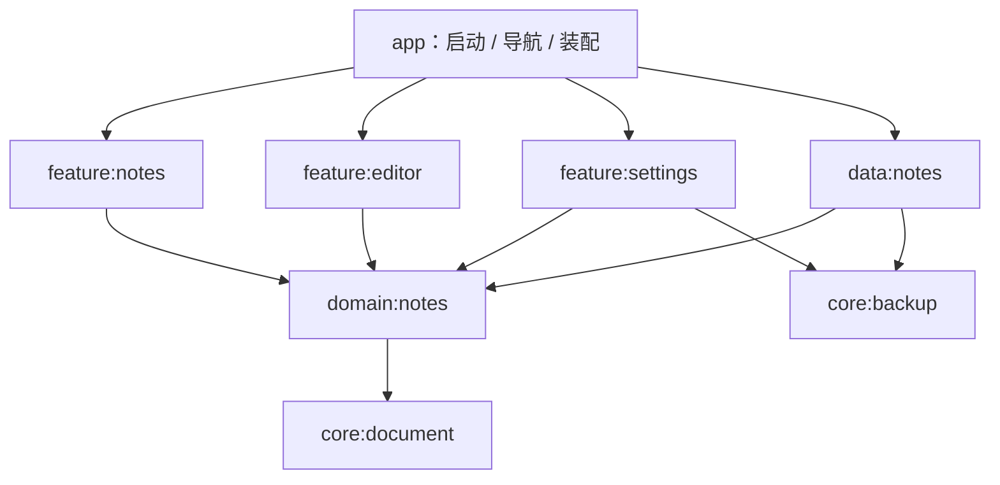

# ADR-001：Android 模块化单体架构

日期：2026-10-18。

状态：架构选型决定及实施约束。本决策替代此前“单个 app 模块起步”的初步参考。2026-10-18 核心架构与数据底层已接入，正式功能层待接入；接口和实际验证结果见[架构交接](../engineering/foundation-handoff.md)，不代表一期产品与设备验收通过。

实施更新（2026-10-23）：已按本决策接入十个实际模块及受控本地阅读适配，状态库显式迁移到 v2。用户调整为功能先行、整体视觉重做后置，默认源码编辑＋阅读；原第 8 节的样板后续顺序以这一最新决定为准，真机输入和最终验收门槛保留。当前实现与范围见[一期功能交接](../engineering/phase-1-function-handoff.md)。

稳定性实现补充：公共引用模型显式区分 WikiLink、Markdown 和 HTML 的路径语义；编辑/阅读使用带修订的显示快照，保存独立运行。多文件回滚结果先落盘再清理；完整恢复返回已提交/已回滚/仍需恢复结果，并在替换前结束旧会话、替换后换代导航。模块边界、状态库 v2 和备份外层 v1 不变，具体协议及验证见[稳定性修复交接](../engineering/phase-1-stability-handoff.md)。

阅读提速实现补充：ReaderCacheRepository 是 domain:notes 的可丢弃派生接口，由 data:notes 实现、app 装配，供编辑阅读与设置调用；不增加模块、权威状态或备份参与者。ReaderSnapshot 复用已核验正文，文档投影保留原文定位；首屏与屏外资源分阶段准备。缓存代次跨普通重启保留，清理/资料替换时换代；具体边界与检查见[阅读提速交接](../engineering/phase-1-reader-performance-handoff.md)。

## 1. 选型结论与比较

2026-11-09 二期架构补充：现有 Life `app` 作为唯一宿主，默认进入 Life，悬浮按钮切换平级的笔记／见域业务域。见域按需初始化并按 domain／data／feature 依赖边界接入，共用渲染不依赖笔记库；切换不销毁生成任务，两域恢复分别换代失效会话。本期备份保持独立，不要求见域接入 Life 的备份包；由 app 显式装配各域备份能力，统一整 App 备份留第五期。当前已新增 `core:markdown` 并由 Life 使用，见域生产模块与切换尚未接入；现有十三个模块的边界见下表。具体交互、进入条件和验收见[二期计划](../plans/phase-2-ai-and-shared-capabilities.md)。

2026-11-14 接入进展：新增见域 domain／data／feature，共十六个实际模块。Room 模型留 data，纯 Kotlin 契约与公开能力供 feature 使用；app 显式装配并按需初始化，通过世代租约协调闭库。`core:markdown` 消息模式依赖纯 `core:document`，生产消息已切换，继续不依赖笔记库。完整迁移／独立恢复使用见域专属格式、持久化替换日志和 epoch；初始打开及失败后的显式重试均先处理恢复记录，普通快照不换内容 epoch。电脑检查与设备门槛见[宿主交接](../engineering/phase-2-business-host-handoff.md)、[迁移交接](../engineering/phase-2-complete-backup-handoff.md)。上方十三模块描述为 11 月 9 日基线。

2026-11-09 四期补充：目录 `主题/类型` 是主归属，标签最多三级并支持交集／并集查询。`createManaged/saveContent` 与原样传输接口分开，内容时间仅在可靠写录／内容修改或人工确认时写入 YAML，整理维护不刷新；批量预览后按版本、草稿、路径复核，复用文件恢复。状态库 v4 增加时间待确认标志和主题顺序，notes 快照 format=4 兼容历史格式，不丢封面、置顶和阅读位置。依赖边界及十二模块数量不变，见[分类交接](../engineering/note-organization-handoff.md)。

2026-11-04 三期同步补充：新增纯 Kotlin `domain:sync` 与 Android `data:sync`；设置功能仅依赖同步领域接口，App 显式装配。笔记域增加 `NotesSyncRepository`，由现有 `data:notes` 在共享门锁内实现，不开放私有路径或 DAO。同步配置、同步附件回收站分别作为可选历史备份参与者；凭据与基线不导出。外层备份仍为 v1，notes 快照仍为 format=3，状态库仍为 v3。新增可选域缺失时显式重置，未知域继续拒绝。具体协议及验证见[三期交接](../engineering/phase-3-sync-handoff.md)。

2026-11-01 视频摘记补充：不新增模块。`feature:notes` 增加对 `core:preferences` 的依赖，用于固定四类视频提示词的覆盖值；正文仍经 NotesRepository 创建普通 Markdown 笔记。提示词属于用户设置，沿用 preferences 备份参与者，新设置快照 format=2 兼容 format=1（含省略版本字段的历史快照），外层备份与 notes 快照格式不变。

2026-10-31 封面实现补充：笔记独立封面属于应用状态，保存在 Room 状态库 v3，显式迁移 v2→v3；旧库默认山野预设。自定义图片沿用私有附件目录及公开资源接口，notes 参与者快照 format=3 兼容读取 1／2，外层备份仍为 v1。封面不写入正文／YAML，不改变正文版本、草稿和索引权威来源；说明与验证见[封面交接](../engineering/phase-1-note-cover-handoff-20261031.md)。上文 v2 为原实现历史状态。

采用 **Kotlin + Jetpack Compose 的模块化单体架构**：一个 Android 安装包，以 Gradle 模块隔离主要职责；按业务域组织功能，界面采用 ViewModel + 单向数据流（UDF），业务通过 Repository 接口访问数据，复杂操作使用 Use Case。借用 Clean Architecture 的依赖方向与可测试性，不要求每次调用都套三层转发。

| 方案 | 优点 | 本项目取舍 |
| --- | --- | --- |
| 单个 app 模块内按功能分包 | 构建简单、初期文件少 | 可做小应用，但对未来多业务及多 AI 接手的依赖约束较弱，不选为整体方案 |
| 适度多模块的模块化单体 | 编译边界清晰，可独立测试，仍只维护一个 App | **选用**；按真实功能逐步创建模块 |
| 每个页面都拆完整 data/domain/presentation 模块 | 隔离细，但配置与转发代码多 | 不选；按业务域拆分，不按页面数量拆模块 |
| 动态插件平台、微服务、跨平台框架 | 适用于另有部署或跨平台要求的产品 | 当前没有对应需要，不建设插件运行时、服务端或多平台层 |

MVVM/UDF 描述界面状态流，模块化描述工程边界，Repository/Use Case 描述业务与数据依赖；它们是不同层次的选择，不是互斥框架。

## 2. 已选技术与实施默认值

| 部分 | 选择 |
| --- | --- |
| 平台与工具链 | 原生 Android、Kotlin、Gradle Kotlin DSL、JDK 17；单 Activity |
| UI | Jetpack Compose + Material 3，自定义已确认的主题颜色，不由系统动态配色覆盖默认设计 |
| 状态 | AndroidX ViewModel、Coroutines、Flow/StateFlow、生命周期感知收集；不引入额外 MVI 状态框架 |
| 导航 | **Navigation 3 稳定版**；应用层管理类型化导航目标和返回栈 |
| 依赖装配 | **Hilt**，优先构造函数注入；纯 Kotlin 业务接口不依赖 Hilt/Android |
| 正文与附件 | App 内部私有文件目录管理 UTF-8 Markdown 和独立附件；系统文件选择器负责外部导入导出 |
| 本地结构化存储 | **Room**：应用状态与派生索引明确区分；不把正文数据库化为另一份权威内容 |
| 简单设置 | **Preferences DataStore**：主题、字号等；不保存正文、密钥或大型业务对象 |
| 序列化 | Kotlinx Serialization 用于本项目 JSON/类型化导航；不用于重写未知 YAML 字段 |
| 测试 | JUnit、kotlinx-coroutines-test；Android 场景使用 AndroidX Test 与 Compose UI Test，优先可控的 fake |
| AI/网络 | 一期不安装聊天或网络业务栈；二期保留见域现有功能和交互，仅作单 App 整合及共用 Life Markdown 的必要适配；Life 文档知识库与新增资料联动归第五期 |
| 后台工作 | 发生真实持久任务需求时再接 WorkManager；不能用它保证精确提醒，也不能用它代替即时编辑保存 |

2026-10-18 核对官方发布页，Navigation 3 已有稳定版（1.2.0），因此选择它而非照搬见域旧版 Navigation Compose。Hilt、Room、Compose 等具体版本由实施者选用兼容的稳定组合，集中固定到 `gradle/libs.versions.toml`；不使用动态版本，不为追新改变本决策。Gradle/AGP/Kotlin/KSP 与 JDK 17 的兼容性须以实际构建验证，遇到冲突先报告，不擅自更换整套架构。

实施补充：实际 AAR 元数据检查确认 Navigation 3 1.2.0 要求 compileSdk 37 与 AGP 9.1，不能用于现有 SDK 36 / AGP 8.13.2 底座。已向用户报告，保留 Navigation 3 方案并选兼容的较早稳定版；最终锁定版本与验证见架构交接。Hilt 保留在支持 AGP 8 的 2.58。

仅交付用户的小米 14 Ultra。`minSdk = 26` 作为构建起始默认值，不代表承诺所有 Android 8 设备均通过体验验收；compile/target SDK 在工程创建时选择兼容的稳定值并记录。目标手机的实际系统版本、输入法和 WebView 版本由首次设备验收记录，不从机型名称猜测。

## 3. 模块边界与依赖

下面是当前实际落地的边界；三期新增模块有真实接口和调用者，不建立远期空模块。

| 模块 | 职责与公开边界 | 允许依赖的项目模块 |
| --- | --- | --- |
| `:app` | 启动、导航组装、Hilt 装配、系统入口；不承载笔记业务 | 实际启用的 feature、data 和 core 模块 |
| `:core:document` | 纯 Kotlin 文档类型、路径/引用模型、语法处理适配边界；保留原文 | 无业务模块依赖 |
| `:core:markdown` | 受控 WebView、共享渲染静态资源、修订校验与原文定位；资源和动作通过宿主回调提供 | 无项目模块依赖 |
| `:core:designsystem` | 主题、排版、通用组件 | 无业务模块依赖 |
| `:core:preferences` | 设置访问接口和 DataStore 实现 | 无业务模块依赖 |
| `:core:backup` | 简单备份包读写、恢复流程及数据参与接口 | 无 feature/data/notes 依赖 |
| `:domain:notes` | 纯 Kotlin 笔记模型、Repository 接口、必要 Use Case | `core:document` |
| `:data:notes` | Repository 实现，文件、附件、草稿、Room、索引与恢复协调；提供笔记备份参与实现 | `domain:notes`、`core:document`；接备份后依赖 `core:backup` |
| `:feature:notes` | 笔记列表、目录/标签、本地搜索、视频摘记的 Route、ViewModel、Screen | `domain:notes`、`core:designsystem`、`core:preferences` |
| `:feature:editor` | 阅读、源码/实时预览编辑、输入与笔记渲染适配、保存 UI 状态 | `domain:notes`、`core:document`、`core:markdown`、`core:designsystem`、`core:preferences` |
| `:feature:settings` | 外观、导入导出、备份恢复和电脑同步的 UI | `core:preferences`、`core:backup`、`core:designsystem`、`domain:notes`、`domain:sync` |
| `:domain:sync` | 纯 Kotlin 同步状态、冲突选择及变化判断 | `domain:notes` |
| `:data:sync` | HTTP、基线、连接配置和配置备份参与者 | `domain:sync`、`domain:notes`、`core:document`、`core:backup`；仅集成测试可依赖 `data:notes` |

设置备份参与实现放在 `core:preferences` 内，在接备份功能时允许其依赖 `core:backup`；备份引擎不能反向依赖设置或笔记模块。App 显式装配参与者，不做运行时扫描、插件安装或事件总线。

图省略主题和设置依赖，完整约束以上表为准。箭头表示编译依赖，不代表运行时数据流。

硬性规则：feature 不依赖其他 feature 或 data 实现；data 不依赖 feature；domain 不依赖 Android、Compose、Room、Hilt。跨 feature 跳转由回调交给 app，参数只传标识及定位信息，不传整个笔记正文、DAO 或 ViewModel。具体实现类型尽量 `internal`，公开接口保持小而明确；禁止全局 Service Locator、业务万能 Manager 和通用事件总线。

需要复杂一致性的保存/重命名/恢复使用 Use Case；简单列表观察和读取可直接调用 Repository，避免空壳转发。不可因每层存在就为同一模型机械创建多套 DTO。

## 4. 数据归属与文件可靠性

用户已选择 App 管理文件夹，通过导入导出和后期同步与电脑交换。一期不开放外部 App 直接编辑活动笔记库，也不请求全盘文件管理权限。

| 数据 | 权威来源 | 恢复原则 |
| --- | --- | --- |
| 正文、YAML 标签/别名、文件夹层级和附件 | 私有目录内 Markdown 与附件文件 | 导出保留可供 Obsidian 使用的结构；未修改内容不能因打开/保存而被格式化清洗 |
| 笔记内部 ID、ID 与路径映射、置顶、阅读位置等 | 笔记模块的 Room 状态库 | 属于需备份的应用状态，不能当作缓存随意清空 |
| 搜索正文、引用关系、摘要等派生数据 | 独立 Room 索引库 | 可从文档重建；索引中的正文副本不能反向覆盖文件 |
| 未保存草稿与未完成文件操作记录 | 私有目录内独立恢复文件 | 用于崩溃恢复，不能当作已保存正文；备份时明确处理尚未保存内容 |
| 主题和字号 | DataStore | 完整备份包含用户设置 |

内部 ID 不由文件名生成；四期 App 新建笔记首次落盘即补齐 `life_archive_id`，历史未参与同步的笔记不因打开而被改写。三期经用户确认，参与同步时定点补齐 YAML `life_archive_id` UUID，已有有效值保留，手机原笔记优先沿用内部 ID。跨端使用 YAML ID 关联到当前本地笔记，不用文件名重建身份，不因接收电脑改名而替换原有内部 ID。完整恢复保留本地 ID；普通文件导入不承诺自动恢复应用专属关联，重复同步 ID 须处理后再同步。

所有正文写入经过笔记 Repository，UI、AI、导入器和未来同步不能绕过它。至少提供观察列表/读取文档、带预期版本的保存、创建、重命名/移动、回收/恢复、附件导入和搜索等明确操作；返回已提交、版本冲突或失败等可识别结果，不以发起写入等同成功。

保存采用同目录暂存文件完成写入后替换；采用存储层串行协调及版本检查，防止旧保存覆盖新编辑。实际文件成功后才报告保存成功；索引失败单独标记待更新并可重建，不把已落盘内容误报丢失。多文件链接更新无法依赖 Room 事务实现原子性，需最小持久操作记录和中断恢复，部分完成不能误报成功。

索引更新、导入、重命名及恢复由笔记模块统一协调。搜索走派生索引，不在每次输入或界面重组时扫描整个文件库；中文查找必须有真实样例验证，不能仅启用默认 FTS 就宣称中文搜索已满足需求。

备份为用户手动导出的普通完整包（ZIP + 简单版本清单），包含正文、附件、应用状态及设置，索引可省略后重建；只做必要的格式、路径和版本检查。恢复暂存验证后经确认替换，失败保留原库与恢复所需记录，不做差异合并。`core:backup` 只编排参与者的导出/恢复/清理，数据所有者负责自己的有效快照；不能在数据库写入中直接复制未关闭的 DB/WAL 文件。

App 私有文件在卸载/清除数据后会丢失，不能把同目录副本称为换机备份；导出通过系统文件选择器写到 App 之外。应用锁/指纹不等于正文加密；安全入口在后续实际实现时接入，不增加访客、伪装或自毁功能。

## 5. 编辑器与 UI 状态

Screen 主要接收状态与动作回调；Route 获取 ViewModel 并收集状态。状态通过只读 StateFlow 向下传递，操作通过方法向上提交。导航、键盘和系统文件选择器由 UI/宿主边界处理，ViewModel 不持有 Activity 或 NavController。

高频输入的正文、选区和中文组合输入由局部 EditorSession 状态管理，和页面加载/保存状态分开；不能把每次按键绕经异步数据库 Flow 再回写输入框。切模式保留同一编辑会话，后台保存只接收带版本的文本快照，成功回执不能重置正在输入的内容。

在 `feature:editor` 内隔离 EditorEngine 与 ReaderRenderer 适配边界。先验证 Compose 原生源码编辑；实时预览或复杂阅读展示可在验证后采用 Compose、Android View 或受控 WebView 适配。整个 App 仍为原生 Compose，底层编辑组件不决定整个项目架构。使用 WebView 时仅加载受控本地资源，隔离笔记中的脚本及原生桥接权限，不让渲染内容直接读写文件。

具体编辑器、Markdown/YAML/公式/Mermaid 渲染库是**明确的样板门槛**，本轮不虚构已经选定或完全兼容。实现者先验证再固定依赖；未通过实时预览门槛时按现有计划采用源码编辑加阅读，完整阅读兼容范围不缩水。组件边界确定后，库的替换应局限于编辑/渲染适配和对应测试。

## 6. 后续扩展如何接入

- **任务/习惯/目标**：获准后增加对应 domain/data/feature 业务域，通过笔记公开接口和 NoteId 关联资料，不直接查询笔记 DAO；有自己的规则与权威数据，不塞进 Note 对象。增加入口由 app 装配；新增数据域须同时接入备份，避免备份遗漏。
- **中山公交出行**：保持独立业务规则与数据归属，公交/地图服务位于该域数据适配层；通过接口关联笔记。是否独立交付仍待定；现阶段不创建模块、Provider 或时刻表 Schema。
- **二期单 App 与共用 Markdown**：以 Life 现有 app 为唯一宿主，默认进入 Life，可拖动悬浮按钮切换并保留各自底栏、导航与输入状态；见域按需初始化，两域各自拥有数据、外观和独立备份。保留见域现有业务与大部分交互，按 domain／data／feature 接入；共用 Markdown 通过不依赖笔记域的公开能力维护一份实现。见域本期不访问 Life 文档，feature 不依赖其他 feature 或 data。流式渲染样板与历史迁移协议按子任务细化并验证，不提前建立跨 App SDK 或空模块。详见[二期计划](../plans/phase-2-ai-and-shared-capabilities.md)。
- **五期知识库与资料联动**：Life 文档作为见域知识库，AI 全库搜索、自动调用资料及其他新增笔记与对话联动归本期；当前仅记录方向，不展开接口或实现设计。未来资料访问仍须遵守笔记域公开接口与数据归属约束，不直接访问私有文件或 DAO。详见[五期方向](../plans/phase-5-knowledge-base.md)。
- **三期电脑同步**：同步适配器经笔记域条件写入接口提交结果，网络不占用存储门锁；共同基线判定变化，双端冲突由用户选一端或跳过。同步前暂停外部编辑并处理草稿，电脑每轮 AI 修改前按文件列表留副本；具体范围以第三期计划为准。
- **提醒**：业务域提供提醒意图，未来独立调度适配处理系统权限和恢复；届时区别精确时间提醒和可延迟后台任务，不在一期预建调度平台。

待确定、不排期的功能用于检验边界，不构成实施授权。生活/重要档案取舍仍待用户决定，不阻塞本架构采用。

## 7. 小米 14 Ultra 与小规模验证基线

用户确认仅使用小米 14 Ultra，约 500 篇笔记。以下为架构选型给出的初始测试默认值，不是用户真实资料统计、文件硬限制或已达成性能承诺：

- 标准库：500 篇中英混合 Markdown，多数约 10 KiB，含目录、标签、链接；增加典型 50 KiB 和 1 MiB 长文样例。
- 附件样例：约 100 个图片/PDF 等文件，总计约 200 MiB，单个 PDF 约 50 MiB，验证流式导入导出，避免整个备份载入内存。不扫描或改动用户真实资料来造测试集。
- 发布近似构建、索引已完成时：列表加载 p95 ≤ 500 ms，本地搜索从最后输入到结果更新 p95 ≤ 500 ms（含防抖），冷启动到可用列表 p95 ≤ 2 s；连续采样至少 20 次并记录设备/系统状态。
- 首次全量索引另测总耗时与进度反馈，不混入热搜索成绩；列表和附件按需加载，长文解析移出主线程。1 MiB 文档单独记录打开/切模式耗时、输入与滚动，不允许崩溃、吞字或内容损坏。
- 默认按本机中文输入法实测组合输入、选择、撤销、键盘遮挡和模式切换；不额外承诺其他手机适配。若样板无法达到目标，先定位实现瓶颈，不直接增加缓存层或缩减内容保真要求。

## 8. 交接给实施者的顺序与验收

2026-10-18 用户确认“体系＋核心数据底层”单独先行：本轮建立真实文档存储、状态与索引隔离、设置、备份和 Debug 接入示例，正式 feature、编辑器和笔记业务后续实现。以下原有顺序继续约束产品交付，但不再要求独立可测的数据底层等待编辑器样板。核心底层验收仅电脑检查，设备项保持未验证。

1. 建立可构建骨架，固定兼容版本；先创建有真实调用的 `app`、`core:designsystem`、`core:document`、`domain:notes`、`data:notes`、`feature:editor`。用单篇文档和最小宿主走通输入、保存、重读、草稿恢复，不提前实现全库或远期模块。
2. 完成编辑器交互/阅读适配样板及色彩样板；目录接口可小，但保存必须真实，不能用内存假数据完成可靠性验收。
3. 样板通过后加入 `feature:notes`、`core:preferences`、`feature:settings`，完成列表/搜索/组织/附件及设置；接入备份时才建立 `core:backup` 并实现笔记、设置两个真实参与者。
4. 检验依赖图无环、feature 不直接依赖 data、纯 Kotlin 模块无 Android 引用；验证替换数据 fake 无需修改界面。具体 Use Case/字段名可依业务实现确定，不能改变文档权威来源和依赖方向。
5. 聚焦测试覆盖中文/Windows 文件名冲突、未知 YAML 保真、保存版本冲突、磁盘写入失败、索引故障可重建、重命名中断恢复、附件跨重启可读、完整备份恢复 ID/关联/设置、导航返回与旋转/进程恢复；逐项验证一期语法兼容样例。
6. 在目标手机执行输入与性能基线、实际完整备份恢复；构建和单测不代替真机结果。交付记录包含锁定版本、模块图、通过/失败与剩余门槛。

未来新增模块必须带来实际职责和调用者；不创建 `tasks`、`travel`、`ai` 等占位工程，不引入独立云服务、插件系统、事件溯源或分布式架构。三期复用现有 PC 本地服务，不改变 Android App 的平台边界。

## 9. 参考依据

以下官方资料用于核对技术能力；模块数量、文件与索引分工、个人使用规模和分期是本项目决策，不是照抄官方模板。

- [Android 架构建议](https://developer.android.com/topic/architecture/recommendations)：分层、Repository、UDF、ViewModel、协程与 Hilt。
- [模块化模式](https://developer.android.google.cn/topic/modularization/patterns)：按职责组织模块和控制依赖。
- [Navigation 3 发布记录](https://developer.android.com/jetpack/androidx/releases/navigation3)：核对稳定版；不采用页面示例中的 alpha 依赖。
- [Hilt](https://developer.android.com/training/dependency-injection/hilt-android)、[DataStore](https://developer.android.com/topic/libraries/architecture/datastore)：依赖装配和设置存储。
- [App 专用存储](https://developer.android.com/training/data-storage/app-specific)、[系统文档访问](https://developer.android.com/training/data-storage/shared/documents-files)：私有文件生命周期与外部导入导出。
- [Compose 文本输入](https://developer.android.com/develop/ui/compose/text/user-input)：文本状态和输入变换；不据此声称完整 Markdown 实时编辑已解决。
