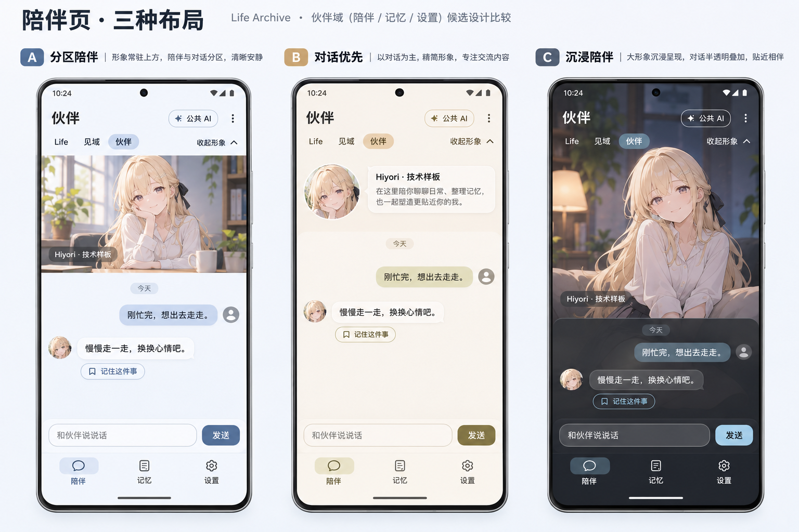
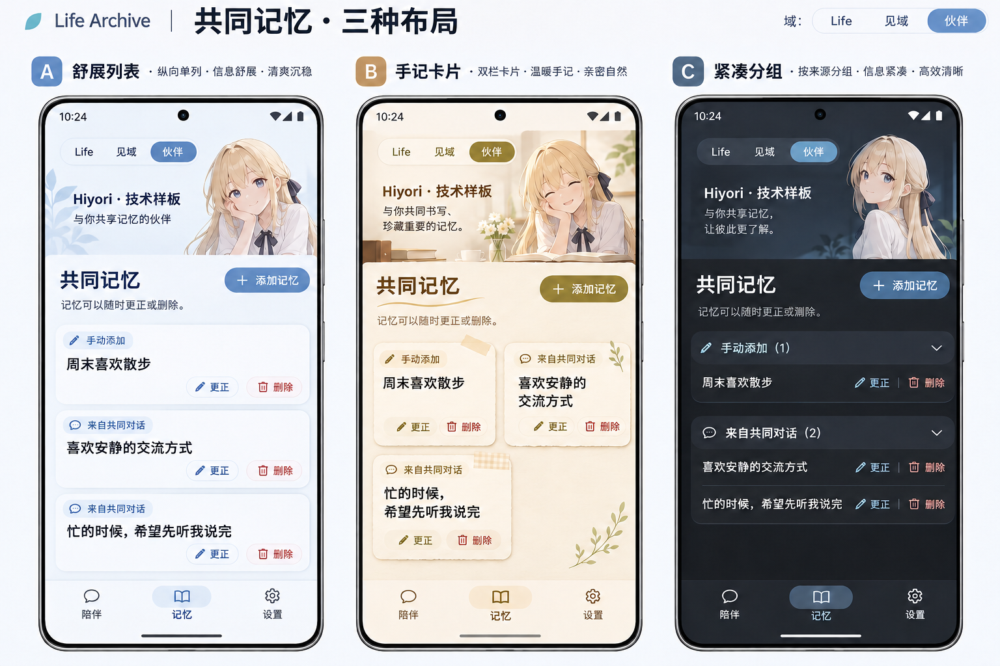
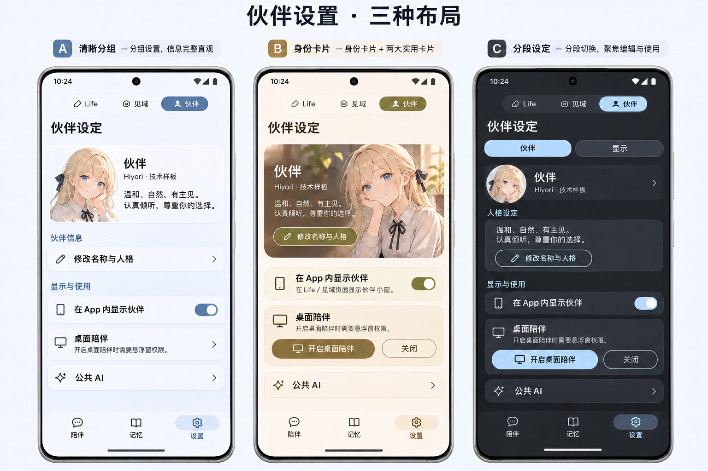
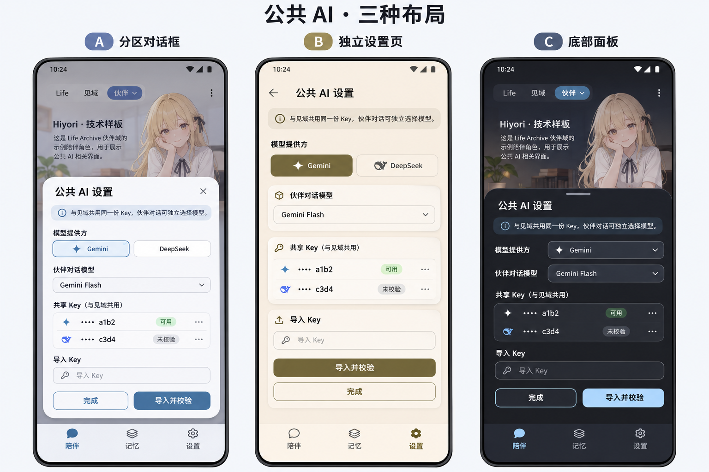
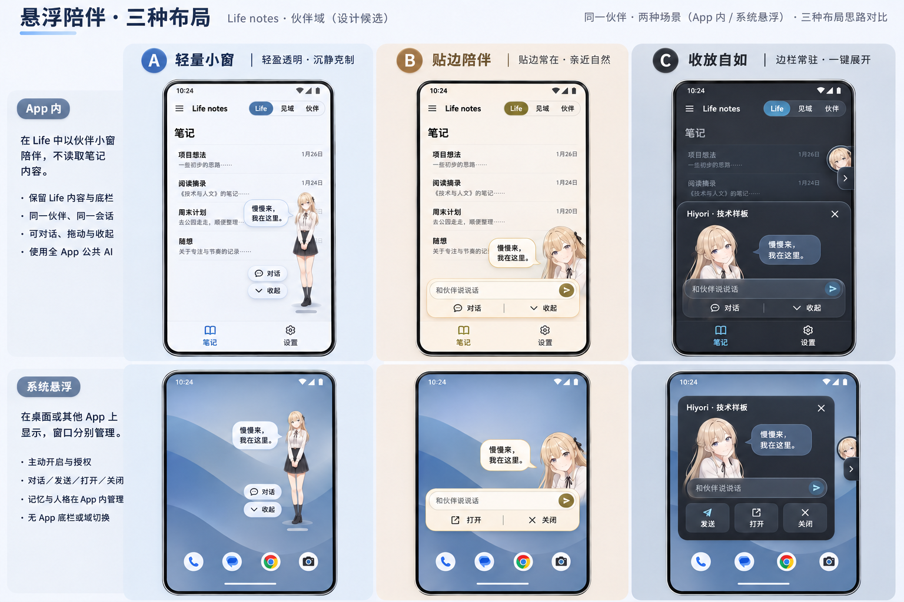
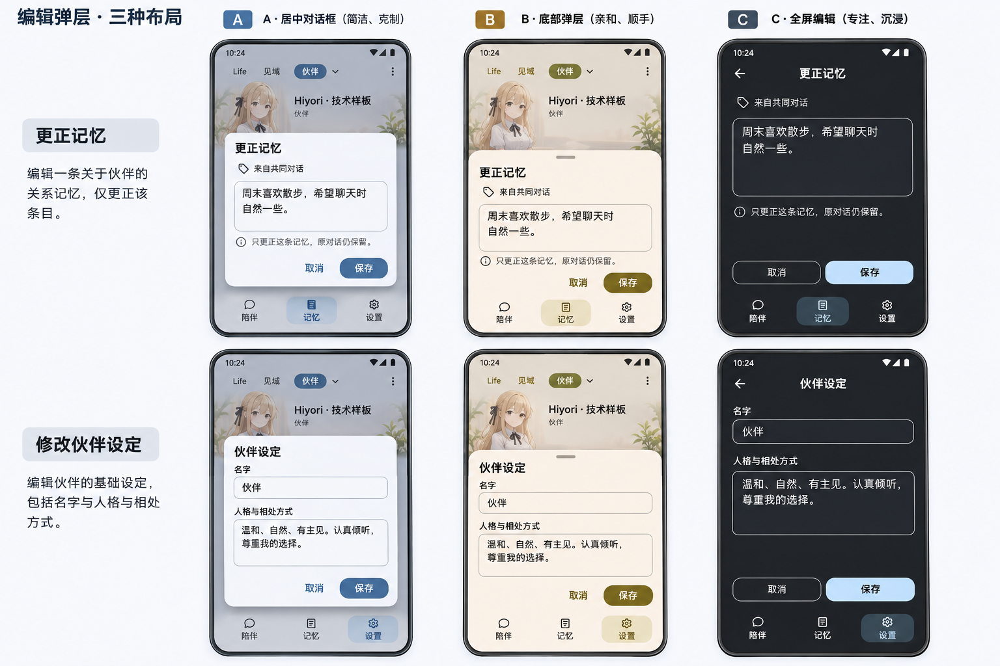

# 伙伴界面候选方案

日期：2026-11-23。状态：**共同记忆已选择 B「手记卡片」并接入；其余页面仍为候选**。实际实现与验证见[手记卡片交接](../../engineering/android-companion-memory-cards-20261123.md)。

使用内置 `image_gen.imagegen` 生成并逐张回读，六张比较板均为 1536 × 1024 PNG。每组包含 A／B／C 三种布局，共十八种页面／形态方案；悬浮与编辑比较板还分别展示两种承载或编辑对象。实际输入和定点修订保存在[生成提示词](PROMPTS.md)。

## 方案对照

| 页面／形态 | A | B | C | 图片 |
| --- | --- | --- | --- | --- |
| 陪伴页 | 上下分区，形象与对话分区 | 对话优先，紧凑头像与气泡 | 大形象与下层对话面板 | [查看](01-conversation-options.png) |
| 共同记忆 | 舒展单列 | 手记卡片 | 按来源紧凑分组 | [查看](02-memory-options.png) |
| 伙伴设置 | 清晰分组列表 | 身份卡片与显示卡片 | 分段设定 | [查看](03-settings-options.png) |
| 公共 AI | 分区对话框 | 独立设置页 | 底部面板 | [查看](04-shared-ai-options.png) |
| App 内／系统悬浮 | 轻量小窗 | 贴边陪伴 | 可收放面板 | [查看](05-overlay-options.png) |
| 记忆／人格编辑 | 居中对话框 | 底部弹层 | 全屏编辑 | [查看](06-editor-options.png) |

A／B／C 的配色分别参考浅灰蓝、暖纸、深石墨。布局和配色可以分别选择，落地仍使用全 App 的主题设置。可以按页面混选，例如“陪伴 A、记忆 C、设置 B、公共 AI B、悬浮 A、编辑 B”。

## 选型边界

- 这些图片是设计图，不是运行截图或 Live2D 验收证据。共同记忆 B 已由用户选择，其余方案待选；实际电脑结果见[原生交接](../../engineering/android-companion-native-handoff-20261123.md)及[手记卡片交接](../../engineering/android-companion-memory-cards-20261123.md)，手机与真实远端服务仍待验收。
- 图中人物及场景背景是设计示意，不代表 SDK 现有模型的精确外观或正式资源；Hiyori 仍只作技术样板，正式伙伴形象之后选择。
- 当前宿主使用可拖动三域菜单；图片中的顶栏切换、贴边收纳、输入面板和弹层形式属于本次选型内容。本次设计聚焦新增伙伴界面，Life／见域继续拥有各自页面和底栏。
- 共同记忆属于伙伴域。更正／删除记忆保留原对话，不默认读取 Life 笔记或见域会话。悬浮图的 Life 内容只是背景排版示例。
- 全 App 只有一个公共 AI 配置与凭据管理方。图中模型名称、遮罩 Key 后缀与校验状态均为排版示例，实际列表和状态以公共 AI 配置为准。
- App 内小窗、伙伴页形象和系统窗口分别管理显示与生命周期。系统窗口需主动开启及授权；记忆／人格在 App 内管理。
- 语音、主动问候、成长、自律及新增备份仍按已确认计划后置；候选图片不扩大这些范围。

已回读并定点修正记忆域选中标识、App 内开关说明、悬浮背景的 Life 两项底栏及越界生成的额外入口。最终归档只保留六张候选比较板。

## 陪伴页

## 共同记忆

## 伙伴设置

## 公共 AI

## 悬浮形态

## 编辑弹层

